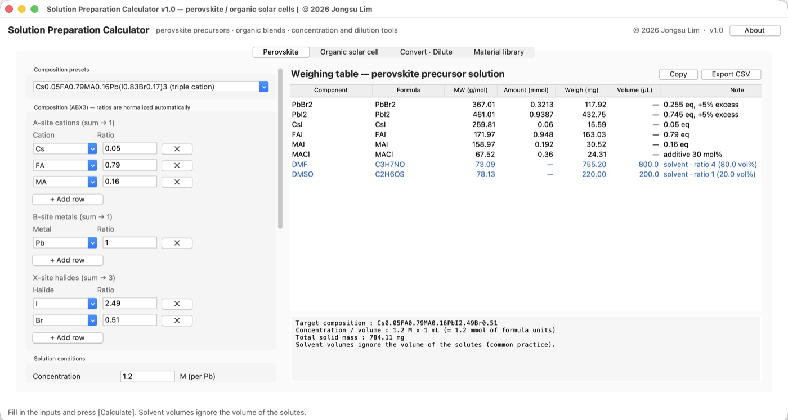
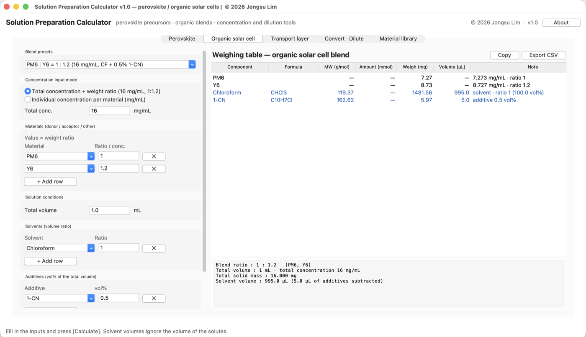
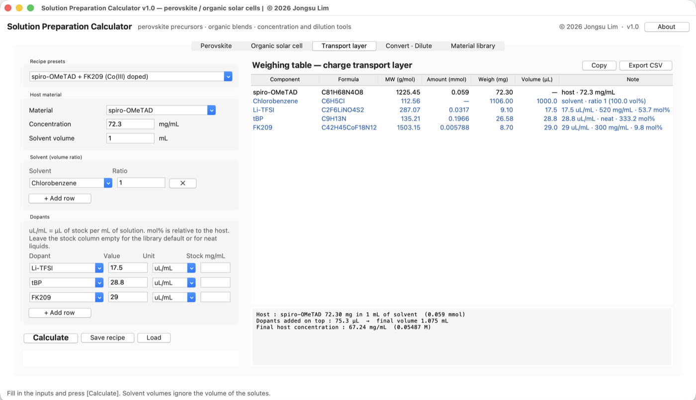
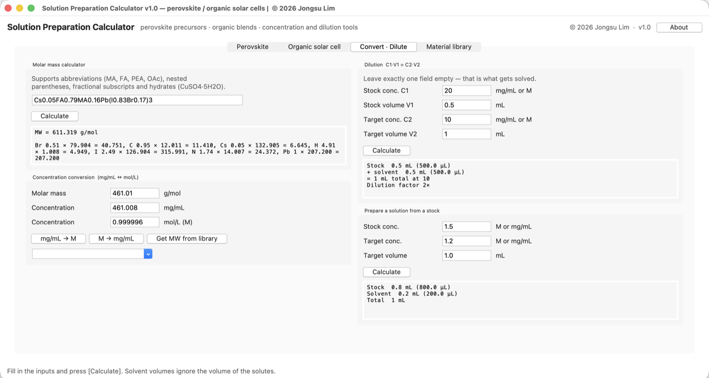
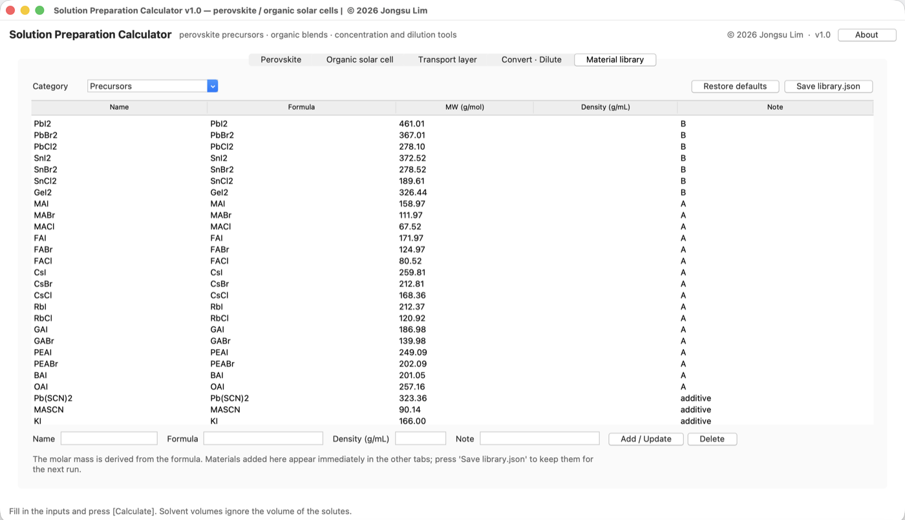

# Solution Preparation Calculator

[](LICENSE)


[](https://doi.org/10.5281/zenodo.23682461)

A desktop GUI calculator for **solution-processed solar cells**. It converts a
target perovskite composition (`ABX3`), an organic donor:acceptor blend ratio or
a doped charge-transport recipe into the masses you actually weigh out and the
volumes you pipette.

Pure Python standard library (tkinter) — nothing to install.

Authors: Hyunsung Ji, Jongsu Lim, Kyungsik Kim, Jaeho Shin, Seungeon Lee, Jinho Lee · v1.0



*A triple-cation recipe: enter `Cs0.05FA0.79MA0.16Pb(I0.83Br0.17)3` at 1.2 M in
1 mL with 5% B-site excess and 30 mol% MACl, and read off what to weigh.*

## Run

```bash
git clone https://github.com/jongsu-king/perovskite-opv-solution-calculator.git
cd perovskite-opv-solution-calculator
python3 solution_calculator.py
```

On macOS you can also double-click `run.command` in Finder.
Requires Python 3.10+ with tkinter (macOS / Windows / Linux).

## Layout

| File | Purpose |
| --- | --- |
| `solution_calculator.py` | GUI (entry point) |
| `calc.py` | Calculation logic — importable without the GUI |
| `chem.py` | Formula parser, molar masses, built-in material library |
| `docs/` | Screenshots used in this README |
| `library.json` | Your own materials (created when you save from the Library tab) |

## Tabs

### 1. Perovskite

Enter an `ABX3` composition and get the precursor salt masses plus solvent volumes.

- **Composition** — A-site (MA/FA/Cs/…), B-site (Pb/Sn/Ge) and X-site (I/Br/Cl)
  as relative ratios; they are normalized automatically to A = 1, B = 1, X = 3.
- **Halide allocation** — the same composition gives different recipes depending
  on whether Br comes from `PbBr2` or from `FABr`/`MABr`. Set `Br → BX2 = 100%`
  to source it from PbBr2, or `0%` to source it from the A-site bromides.
  If the A-site salt budget is exceeded, the split is adjusted automatically and
  a warning is shown.
- **B-site excess** — the usual `5% PbI2 excess` practice, entered as a percentage.
- **Additives** — e.g. `30 mol% MACl`, given as mol% of the formula unit.
- **Solvents** — a volume ratio such as `DMF : DMSO = 4 : 1`.

Example — `Cs0.05FA0.79MA0.16Pb(I0.83Br0.17)3`, 1.2 M, 1 mL, Br→PbBr2 100%,
5% B-site excess:

| Component | Weigh |
| --- | --- |
| PbI2 | 432.7 mg |
| PbBr2 | 117.9 mg |
| CsI | 15.6 mg |
| FAI | 163.0 mg |
| MAI | 30.5 mg |
| DMF / DMSO | 800 µL / 200 µL |

### 2. Organic solar cell



- **Total concentration + weight ratio** (e.g. 16 mg/mL, PM6:Y6 = 1:1.2), or an
  **individual concentration (mg/mL)** per material.
- **Additives** — DIO, 1-CN, DPE … as `vol%` of the total volume; that volume is
  subtracted from the solvent. Additives with a known density also report a mass.

### 3. Transport layer



Doped hole- and electron-transport solutions, where the dopants are pipetted
from stock solutions rather than weighed.

- **uL/mL** — µL of stock per mL of solution, which is how the standard recipes
  are written; it scales automatically with the batch volume.
- **mol%** — relative to the host, for when you want to vary the doping level.
  Both inputs agree: the standard spiro recipe entered either way lands within
  0.03 µL.
- Stock concentrations default to the library (Li-TFSI 520 mg/mL in ACN,
  FK209 300 mg/mL in ACN) and neat liquids such as tBP use their density.
- Dopants are added **on top of** the solvent volume, as in the published
  recipes; the summary reports the final volume and host concentration.

The standard doped spiro-OMeTAD solution (72.3 mg/mL in chlorobenzene, 1 mL) is
reproduced exactly: Li-TFSI 17.5 µL, tBP 28.8 µL, FK209 29 µL.

### 4. Convert · Dilute



- Molar mass calculator — handles `Cs0.05FA0.79MA0.16Pb(I0.83Br0.17)3`,
  `Pb(OAc)2·3H2O`, `PEAI` and similar notation.
- `mg/mL ↔ mol/L`, with molar masses pulled from the library.
- Dilution `C1V1 = C2V2` — leave the unknown field empty.
- Prepare a target solution from a stock.

### 5. Material library



Browse, add, edit and delete precursors, solvents, organic materials and
transport-layer materials. Enter a
formula and the molar mass is derived; enter a density (g/mL) for solvents and
masses are reported alongside volumes. `Save library.json` persists your changes.

## Formula notation

- Nested parentheses: `Cs0.05(FA0.83MA0.17)0.95Pb(I0.83Br0.17)3`
- Fractional subscripts: `Cs0.05`
- Hydrates: `Pb(OAc)2·3H2O` (`·`, `*` and `.` are all accepted)
- Abbreviations: `MA`, `FA`, `GA`, `EA`, `PA`, `BA`, `OA`, `PEA`, `PMA`, `TBA`,
  `OAc`, `Me`, `Et`, `Ph`

## Assumptions

- Solvent volumes **ignore the volume of the solutes**, which is the usual
  practice in solution processing. Use a volumetric flask if you need the exact
  final volume.
- The perovskite concentration is the molarity of the **formula unit**, i.e. of
  the B-site metal.
- A warning appears when a component falls below 2 mg (1 mg for blends), where
  weighing error dominates and a stock solution is more reliable.
- Polymers and non-fullerene acceptors (PM6, Y6, ITIC …) ship without a molar
  mass, since blends are mass-based. Add a formula or MW in the Library tab if
  you need molar amounts.

## Export

- **Copy** — table and summary as plain text, ready for a lab notebook.
- **Export CSV** — table, summary and warnings (opens directly in Excel).
- **Save / Load recipe** — the full set of inputs as JSON.

## License

MIT — Copyright (c) 2026 Jongsu Lim. See [LICENSE](LICENSE).

Free to use, modify and redistribute as long as the copyright notice is kept.
If it helps your research, a citation is appreciated:

```
H. Ji, J. Lim, K. Kim, J. Shin, S. Lee, J. Lee,
Solution Preparation Calculator for Perovskite and Organic Solar Cells,
v1.0 (2026). Zenodo. https://doi.org/10.5281/zenodo.23682462
```
